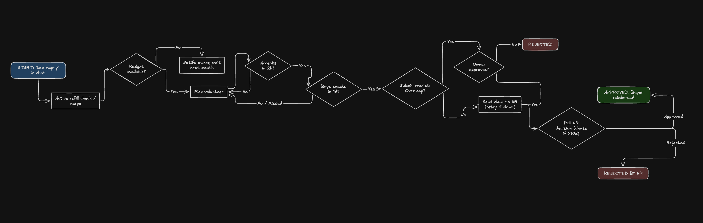

# Snack Counter Automation: Design

## What "automate" means here
The system owns the coordination: who buys, by when, how much may be spent, and chasing the money.
Humans only do what needs a human: buy snacks and photograph the receipt. A bot in the company chat
drives it; chat identity = company login = HR employee id, so there are no separate accounts.

## Lifecycle: empty -> reimbursed
1. Someone reports "box empty" in chat, optionally saying what ran out first. One active refill per office;
   repeat reports join it.
2. Budget check FIRST: cap = min(top of typical purchase, budget left this month). If the cap is below a
   typical purchase, nobody is asked; the budget owner is told and the refill waits for next month.
3. OFFERED: one volunteer is asked, told the cap, and has 2 working hours to accept or decline.
4. ACCEPTED: they have 1 working day to buy. One reminder 2 working hours before the deadline.
5. CONFIRMING: deadline passed -> "did you buy?". "No" or 2 working hours of silence -> next person.
6. PURCHASED: receipt recorded (amount <= cap, optional items list). Claim sent to HR (amount, currency,
   description incl. refill id, receipt, employee id). If HR is down the purchase is kept and retried;
   the refill is NOT handed to someone else.
   Receipt over the cap (or past the budget): recorded as AWAITING_ADMIN; hand-offs stop (the box IS full),
   the budget owner approves (claim sent; never past the monthly budget) or rejects.
7. CLAIM_SUBMITTED -> APPROVED or CLAIM_REJECTED_BY_HR (polled). Pending over 10 days -> admin chases HR.
Anyone can `volunteer` for an OPEN refill (e.g. after the "nobody available" ping); first one wins.

All deadlines are in working time per office (local time zone, 09-17, Mon-Fri, DST-aware):
a Friday-evening offer does not expire over the weekend.

## Parts and the data each keeps
- Refill service (this repo) is the system of record for: refills (status, holder, deadlines, cap,
  attempt history with outcomes, purchase + items, "ran out" feedback, HR claim id) and the volunteer
  roster (volunteer flag, usual office weekdays, visits). These do not exist in any company system.
- Directory / HR (read): employee id, home office, payroll currency, leave. Read at decision time.
- Chat adapter: sends DMs / office messages, forwards commands. Stateless.
- HR adapter: createClaim / getClaimStatus. HR is the source of truth for approval and payout.
- Report: computed from refills; per office: budget, spent, approved, awaiting HR, awaiting budget owner,
  items bought, what ran out.

## How each problem is prevented
- Box empty for days: a named person, short accept window, working-hours clock, reminder, automatic hand-off,
  and an office-wide ping (once, not every tick) when nobody is left.
- Two people buying: one active refill and one holder per office; `volunteer` is first-wins. A previous
  holder who bought late is still reimbursed if nobody else has bought; the current holder is told to
  stand down. A true double purchase is refused and escalated to the budget owner, not silently dropped.
- Few people doing everything / waiting for money: ranking = fewest unreimbursed purchases, then fewest
  offers in 90 days (declining uses your turn), then longest since last offer. Stuck claims are chased.
- Unknown spend: monthly report per office. Unapproved claims count as spend (HR takes up to 10 days).
- Which snacks get eaten: "ran out first" on the empty report, items on the receipt submission.
- Hybrid / holiday / visits: only volunteers in the office on the next working day are asked
  (usual weekdays, minus leave; a visitor counts at the office they visit).

## Money and currency
Integer minor units. Budgets and months are per office, in the office's time zone. Report gives totals
per currency, plus one combined total only if the caller supplies FX rates (no rate is guessed).
The claim is sent in the receipt currency; we ASSUME HR converts to payroll currency (to confirm).
Budget is always counted in the office's currency, whatever the buyer's payroll currency is.

## Trade-offs
- Reserving the top of the typical range can block a refill that would have fitted. Safer than the buyer
  finding out after paying. A receipt over the cap is refused and sent to the budget owner to decide.
- Exactly one active refill per office makes double buying impossible, but there is no "top-up" refill.
- Working hours are fixed per office; public holidays are not modelled.
- Retrying a claim is only safe if HR deduplicates. The brief's HR API has no idempotency key; we send
  one and put the refill id in the description. If HR can't dedupe, a timeout (claim created, reply lost)
  could duplicate a claim. Then: retry only on clear connection failures and reconcile the rest by hand.
- Someone still has to report the box empty; that step has the same "someone else will" problem.
  Cheap fix, not built: a daily "is the box empty?" prompt to one in-office volunteer.
- Everyone who was tried is excluded for the rest of that refill; after that only the office ping and
  `volunteer` remain.
- Polling HR instead of webhooks; "APPROVED" is not proof of payout.
- In-memory store. Production needs a unique constraint on one active refill per office and
  compare-and-set on status, since the code relies on single-threaded JS.

## Deliberately not built
- Real chat/HR integrations, persistence, auth, admin UI.
- OCR of receipts (buyer types the amount), predictive restocking, supplier ordering.
- Calendar integration (office days are a weekly pattern in the roster).
- Budget-owner UI (decisions are a single `adminResolve` call), monthly budget changes, top-up refills.

## Questions for Framsikt
1. Does the HR API accept any currency, or must we send the payroll currency (visitors)?
   Does it deduplicate claims (idempotency key), or must we never retry blindly?
2. Can HR notify us (webhook) on approval and on payout?
3. Does any company system expose office days or leave, or does the roster have to own them?
4. Is the budget a hard limit? Who owns it per office, and may they approve an overrun?
5. Does management want one combined total, and at which rate (monthly average, month end)?
6. Can volunteers be assigned, or must every refill be opt-in? May visitors buy at the other office?
