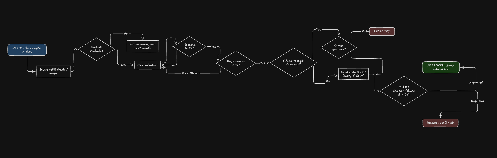

# Snack Counter Automation

Core logic for coordinating snack-box refills in the Oslo and Bengaluru offices: who buys, by when,
how much may be spent, and getting the volunteer reimbursed through HR. The chat tool and the HR
system are simulated (`src/fakes.ts`). Design rationale and trade-offs: [DESIGN.md](DESIGN.md).

TypeScript, zero runtime dependencies (dev only: typescript, vitest, tsx).



## Setup

Requires Node.js 22.12+ (or 24+) and npm.

```sh
git clone <repo-url> framskit && cd framskit   # or unzip the hand-in
npm install
npm test            # 48 tests
npm run typecheck   # tsc, strict mode
npm run demo        # walkthrough below
```

| Command                        | What it does                                   |
| ------------------------------ | ---------------------------------------------- |
| `npm test`                     | Run all tests once                             |
| `npx vitest`                   | Tests in watch mode                            |
| `npx vitest run -t "budget"`   | Only tests whose name matches "budget"         |
| `npm run typecheck`            | Type-check `src`, `test` and `demo`            |
| `npm run demo`                 | Run the demo scenario in `demo/demo.ts`        |

## Demo use case

`npm run demo` plays one week, Monday 16 November 2026, with a simulated clock:

Oslo volunteers: anna (in office Mon-Fri), bjorn (in office Tue-Thu), carla (on holiday), and
priya (Bengaluru employee visiting Oslo this week). Bengaluru: ravi.

1. Erik reports the Oslo box empty, chips ran out first. The system reserves budget and offers the
   job to anna with a cap of 1200 NOK. bjorn (working from home) and carla (holiday) are not asked.
2. A second "empty" report joins the same refill, so nobody else is asked to buy.
3. anna does not answer within 2 working hours; the offer moves to priya, who accepts.
4. priya gets a reminder, the deadline passes, and she is asked "did you buy?" before anyone
   else is. She says no.
5. On Tuesday bjorn is in the office, gets the offer, buys for 850 NOK. HR is down: the receipt is
   kept and the claim is retried on the next tick (no duplicate claim, no second buyer).
6. HR approves on Friday. Bengaluru does a refill for 2400 INR.
7. The monthly report shows budget, spent, approved, awaiting HR and what ran out per office, plus a
   combined total in NOK using a rate the caller supplies.

Excerpt of the output:

```
[Mon 12:00] Anna has not answered within 2 working hours
    DM  -> anna       No answer on refill-1; offering it to someone else.
    DM  -> priya      You're up to refill the OSLO snack box (refill-1). Spend up to 1200.00 NOK. Please accept or decline by Mon 16 Nov 14:00 (Europe/Oslo).
...
[Tue 12:00] Buy deadline passes: she is asked before anyone else is
    DM  -> priya      Did you buy snacks for refill-1? Submit the receipt, or answer "no" and it goes to someone else.
...
Monthly report 2026-11
    office      currency     budget      spent   approved  awaitingHR  remaining  ran out first
    OSLO        NOK         6000.00     850.00     850.00        0.00    5150.00  {"chips":1,"chocolate":1}
    BENGALURU   INR        15000.00    2400.00       0.00     2400.00   12600.00  {"biscuits":1}
    combined: 1138.00 NOK (caller-supplied rate: 1 INR = 0.12 NOK)
```